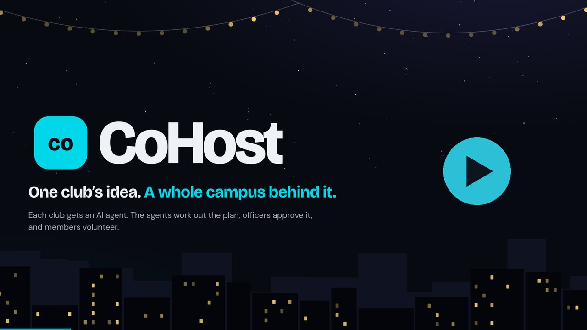

# CoHost

**One club’s idea. A whole campus behind it.**

**[Open the live app →](https://cohost-redesign.vercel.app/)** — use CoHost in your browser; no local setup required.

CoHost helps campus organizations plan shared events, coordinate resources, and recruit volunteers. Each club’s agent works within its club’s constraints to propose a shared plan. Club officers approve their own commitments, and students choose the volunteer shifts that fit their availability and skills.

[](docs/demo.mp4)

▶️ **[Watch the 80-second demo](docs/demo.mp4)**: Hack Night goes from the plan to the approvals to the volunteers. Try it yourself at [cohost-redesign.vercel.app/demo](https://cohost-redesign.vercel.app/demo), no account needed.

Built for the [Cubbie Hackathon](https://hackathon.cubbie.ai), Track 3 (Group Chat Assistant).

## Track 3 at a glance

| Track 3 asks | CoHost |
| --- | --- |
| An AI that joins a group and makes it more useful | Each club brings an agent into a shared event workspace with its partner clubs. The agents turn each club's private limits into one plan, and the officers of every club in the event can read each message they exchange. CoHost is a web app, not a plug-in for a messaging app |
| Something students would want to invite in | Officers type their limits once in a private brief; the agent drafts the plan, catches conflicts and explains what changed. Members never sit through the back-and-forth: they just pick a shift |
| Tied to real campus life | Club events that need several organizations: funding split across clubs, members still in class, setup deadlines, volunteer shifts that fit each student's time and skills |
| A working prototype on a real scenario | Live at [cohost-redesign.vercel.app](https://cohost-redesign.vercel.app/) with Supabase accounts, plus a no-account [Hack Night demo](https://cohost-redesign.vercel.app/demo) |
| Conflicting constraints, what is shared, when people confirm | Briefs stay with their club's officers; only offers, conditions and timing are shared. Agents keep contributions within each club's saved limit and schedule setup around its deadline; in the demo, a workshop set while Design Club is still in class is flagged and fixed in version 2. Agents never commit a club: each club's officers approve their own part of the current version, and any change voids earlier approvals |

## Overview

Campus events often depend on resources spread across several organizations: one club has the idea, another has funding, and another has the people or equipment. CoHost brings these contributions into a shared workflow with clear responsibilities and explicit approval.

The Hack Night demo follows three clubs through a scheduling conflict, a revised agreement, officer approvals, and volunteer recruitment.

## Core features

- **Agent coordination:** Rules-based agents propose funding allocations and scheduling adjustments using each club’s saved constraints.
- **Private club briefs:** Officers define contribution limits, deadlines, and internal priorities. Private notes remain accessible to their club’s officers.
- **Versioned approvals:** Each club approves its own commitment to the current plan. Changes require renewed approval.
- **Volunteer recruitment:** Organizers publish shifts after the required approvals. Students confirm or cancel their own eligible shifts.
- **Role-based access:** Club roles distinguish members from officers and control access to planning and approval workflows.

The interactive demo uses isolated, in-memory state and simulated account switching. It provides a guided example without creating live accounts or granting access to production data.

## Technology

CoHost is a standalone TanStack Start application built with React and TypeScript. Supabase provides authentication and PostgreSQL storage; Vercel hosts the application.

## Local development

### Requirements

- Node.js 24 or later
- npm
- A configured Supabase project for live account and database features

### Setup

```sh
npm ci --ignore-scripts
cp .env.example .env.local
```

Set these public client configuration values in `.env.local`:

```dotenv
VITE_SUPABASE_URL=https://your-project.supabase.co
VITE_SUPABASE_PUBLISHABLE_KEY=your-publishable-key
```

Use a publishable key for browser configuration. Keep service-role keys and other server credentials out of `VITE_*` variables and version control.

Start the development server:

```sh
npm run dev -- --host 127.0.0.1 --port 4173
```

## Using CoHost

1. **Create an account.** Register at `/auth` and confirm your email. The live workspace at `/app` requires Supabase authentication.
2. **Create or join a club.** Members can join directly; requested officer roles require confirmation by an existing officer.
3. **Start an event.** Create the event and invite partner clubs before the first proposal.
4. **Define club constraints.** Each club’s officers save a private brief, contribution limit, and any relevant setup deadline.
5. **Coordinate a plan.** Agents propose contributions and timing within the saved limits. Insufficient funding prevents a proposal from proceeding.
6. **Collect approvals.** Each participating club approves its own commitment to the current version.
7. **Recruit volunteers.** The organizer adds shifts and opens sign-ups after all required approvals. Students save their availability and skills, then choose eligible shifts.

Refresh the workspace to view other users’ changes. Cancelled shifts reopen for eligible students; recommendations do not enroll anyone automatically.

## Backend and access control

Authorization is enforced in PostgreSQL using Supabase Auth identities and row-level security. Client table access is SELECT-only. Writes pass through authenticated invoker wrappers that call checked functions in a private schema.

The database enforces club permissions, private brief access, current-version approvals, organizer-only publication, volunteer eligibility, shift capacity, and overlapping-shift restrictions. Authorization uses `auth.uid()` rather than a client-supplied identity. Funding commitments represent pledges; CoHost does not process payments.

### Database setup

For a new, empty Supabase project, apply the SQL files in this order:

1. `db/migrations/20261025000000_cohost_init.sql`
2. `db/hardening.sql`
3. `db/workflows.sql`
4. `db/private-api.sql`
5. `db/migrations/20261025060000_club_roles.sql`
6. `db/migrations/20261025070000_instant_join.sql`

The club-role migration adds officer roles, display names, event details, and restricted access to plans, agent messages, and approvals. The instant-join migration enables direct membership while retaining officer approval for elevated roles.

Apply each migration once. Do not replay the initialization files against an existing CoHost database.

## Validation

```sh
npm run typecheck
npm test
npm run build
npm audit
```

Additional database checks:

- `db/tests/live-security.sql` contains 34 pgTAP assertions using transactional fixtures and rolls back its changes.
- `db/tests/club-roles.sql` checks club-role permissions and rolls back its changes.
- `VERIFICATION.md` records verification results and known limitations.

Run database checks in a test environment with a privileged SQL session; the assertions switch between anonymous and authenticated roles.

## Deployment

Import `Samriddhi206/cohost` into Vercel and configure:

- **Install command:** `npm ci --ignore-scripts`
- **Build command:** `npm run build`
- **Environment variables:** `VITE_SUPABASE_URL` and `VITE_SUPABASE_PUBLISHABLE_KEY`

Nitro’s Vercel preset generates `.vercel/output`, including the server function. The application uses server routing rather than an SPA rewrite.

In Supabase Auth, set the Site URL to the deployed origin and allow the exact `/auth/callback` and `/reset-password` URLs. Keep email confirmation enabled and configure an SMTP provider for confirmation and password-reset delivery to users outside the project team. Verify signup, confirmation, sign-in, and password recovery on the deployed application.
